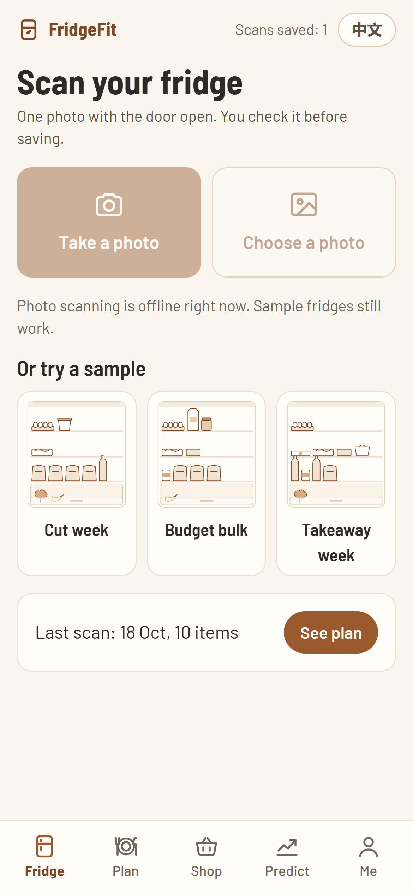
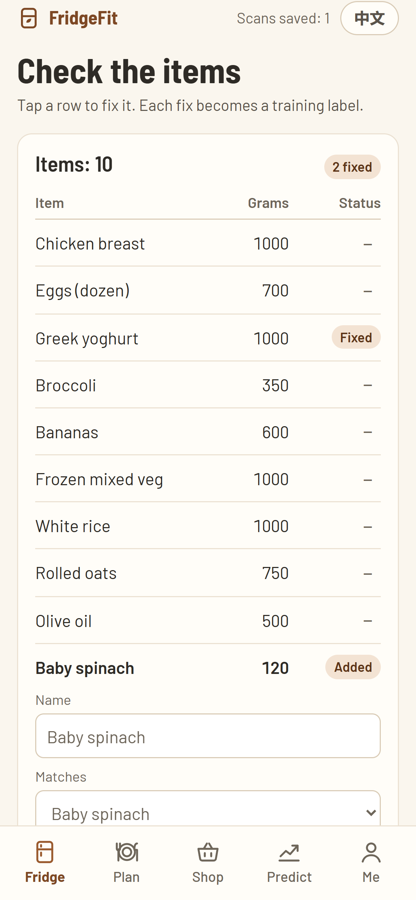
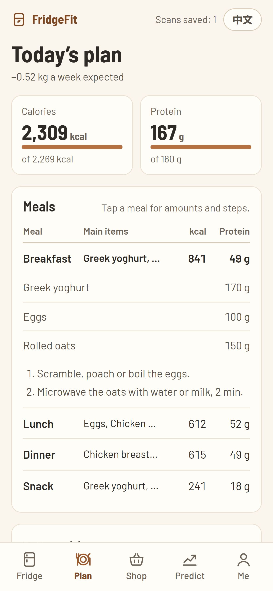
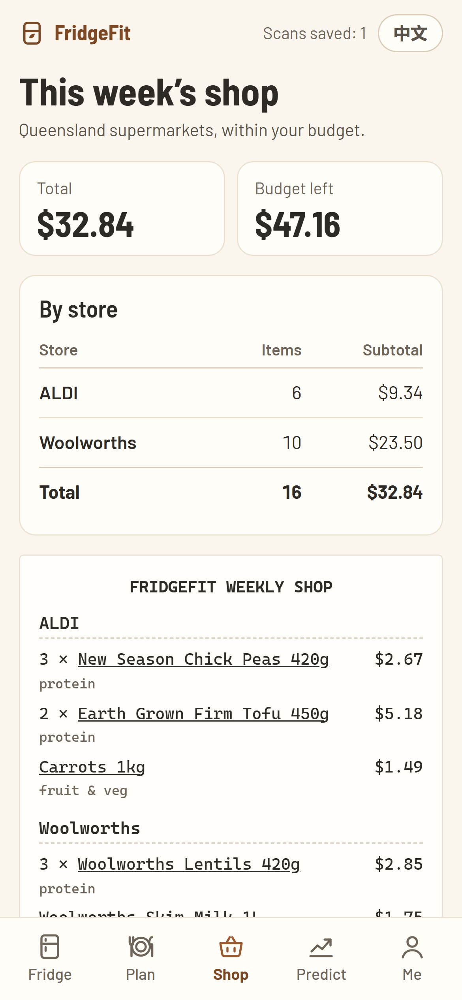
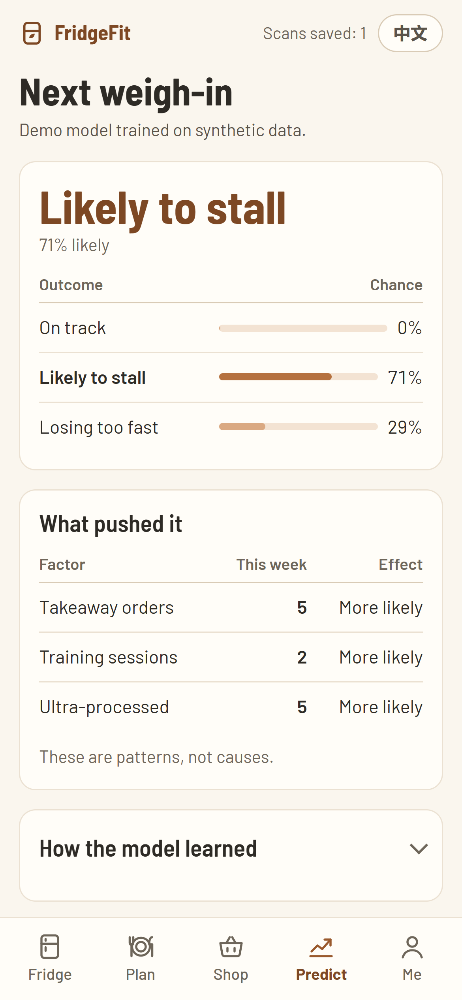

# FridgeFit

**Photograph your fridge. Get today's meals from what is already in it, a budget shopping list from Queensland supermarkets,
and a prediction of whether next week's weigh-in is on track.**

FridgeFit is a student prototype for UQ COMU1130 *Data & Society*, Assessment 3: "Your Data-Driven Smart Solution".
It is built for university students who train at the gym and want to lose fat, maintain or build muscle on a student budget.

**Live demo:** https://fupoos.github.io/fridgefit/. It works on a phone, with no account and no key. Sample fridges work offline.

| Scan | Check | Plan | Shop | Predict |
|---|---|---|---|---|
|  |  |  |  |  |

## The idea

The pitch's hidden pattern: what is stocked in your fridge each week predicts whether next week's weigh-in moves towards
your goal better than your intentions do.

There are two supervised-learning steps:

1. **Recognition.** Photo → list of foods, using **Claude Opus 5.5** (`claude-opus-5-5`) with a structured-output JSON schema limited to our food table. The **Check** screen is where users fix mistakes, and every fix is a labelled example.
2. **Progress prediction.** Nine weekly features (fridge composition, training, steps, sleep, takeaway orders) → `on-track` / `stalled` / `too-fast`. The label comes from the next weekly weigh-in. In this prototype the model trains in the browser on **synthetic** data (see [MODEL_CARD.md](MODEL_CARD.md)).

The calories, macros, meal plan and shopping list are **not** produced by AI. They come from transparent, unit-tested rules:

- Mifflin–St Jeor energy needs;
- USDA nutrition values;
- a greedy planner that uses soon-to-expire food first;
- a best-value-per-dollar shopping planner limited to a Woolworths/Coles/ALDI catalogue.

## Safety and privacy by design

- **Calorie floor.** No plan goes below a floor of max(BMR, 1200/1500 kcal).
- **Limit on the rate of loss.** Cuts are capped at about 1% of body weight per week.
- **Refused cut plans.** Cuts are refused for under-18s, for a current BMI under 18.5, and for a target BMI under 18.5. Refusals show supportive wording and the Butterfly Foundation helpline.
- **No streaks, scores or shaming copy.**
- **Data stays on the device.** Everything is stored in the browser (`localStorage`). There is an export button and a delete-all button. The "data donation" switch is a prototype of the opt-in flow and sends nothing.
- **The API key never reaches the browser.** Photos go to a small scan server (`worker/`, a Cloudflare Worker) that holds the key and calls Claude. It only accepts fridge-recognition requests from the app's own origin, fixes the model and prompt on the server, and caps paid calls per minute and per day. It does not store or log photos.
- **Only the photo is sent.** It is shrunk and re-encoded to JPEG, which removes GPS/EXIF data. Body measurements are never sent.
- **What Anthropic does with the photo.** By default Anthropic does not train on API inputs and deletes them within 30 days; data is stored in the US. A zero-data-retention agreement would be the next step before a real launch.

## Run it

```bash
npm install
npm run dev          # http://localhost:5173/fridgefit/
npm test             # unit tests for the app and the scan server (Vitest)
npm run build
npm run screens      # Playwright screenshots → docs/screenshots (uses installed Chrome)
node scripts/build-data.mjs   # regenerate src/data from the research files
```

Photo scanning needs the scan server. Without it (`VITE_SCAN_URL` unset), the app says scanning is unavailable and
sample fridges still work. Photo scanning is turned off for under-18s, because Anthropic requires extra safeguards such
as age checks for products used by minors.

## Scan server (`worker/`)

The Anthropic key lives only in the Worker's secrets, never in this repository or the web app.

1. `cd worker && npm install`, then `npx wrangler login` to sign in to your Cloudflare account.
2. `npx wrangler deploy`, and note the `https://fridgefit-scan.<your-subdomain>.workers.dev` address it prints.
3. In the Cloudflare dashboard, open the Worker → **Settings → Variables and Secrets** and add a **Secret** named
   `ANTHROPIC_API_KEY` with a key from the [Claude Console](https://platform.claude.com/settings/keys).
4. Point the app at it: `gh variable set SCAN_URL --body "https://fridgefit-scan.<your-subdomain>.workers.dev/scan"`,
   then re-run the Pages workflow.

Limits are set in `worker/wrangler.jsonc`: `DAILY_SCAN_LIMIT` paid calls per UTC day (default 60; a retry counts) and 30
requests a minute. One call uses at most 5,000 output tokens, so 60 calls cost at most about US$7 a day at Opus 5.5
prices ($4 / $20 per million input / output tokens); a typical scan costs a few cents. Claude Max subscribers can fund
this with their monthly API credit (claude.ai → **Settings → Billing → API credits**).

## Project layout

```
src/lib/      nutrition, safety, planner, shopping, recognition, scan, image, storage (all unit-tested)
src/i18n.ts   English / 中文 dictionaries (switch in the top bar or Settings)
src/model/    synthetic data, softmax regression, feature extraction
src/data/     generated food table + Queensland catalogue, demo fridges
src/pages/    Welcome, Profile, Fridge, Confirm, Plan, Shop, Predict, Log, Settings
e2e/          Playwright screenshot run
worker/       scan server: Cloudflare Worker that calls Claude with the server-side key
```

Data sources: [DATA_SOURCES.md](DATA_SOURCES.md). Not medical advice.
